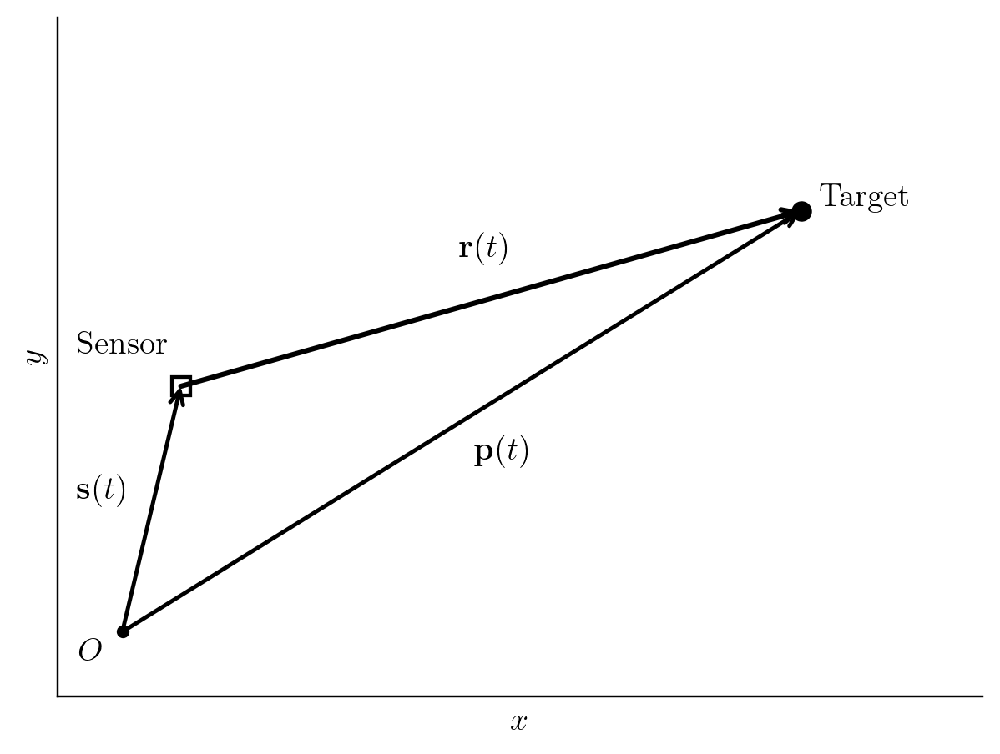

# Target Motion Analysis (TMA) Equations of Motion

## 1 Derivations in 2-Dimensional Cartesian Coordinates

### 1.1 Sensor and Target States

#### 1.1.1 Sensor Position, Velocity, and Acceleration

The sensor position is denoted

```math
\mathbf{s}(t) =
\begin{pmatrix}
s_x(t) \\
s_y(t)
\end{pmatrix}.
```

The sensor velocity, $\dot{\mathbf{s}}(t) = \frac{d}{dt}\mathbf{s}(t)$, and sensor acceleration, $\ddot{\mathbf{s}}(t) = \frac{d^2}{dt^2}\mathbf{s}(t)$, are given as


```math
\dot{\mathbf{s}}(t) =
\begin{pmatrix}
\dot{s}_x(t) \\
\dot{s}_y(t)
\end{pmatrix},
\quad
\ddot{\mathbf{s}}(t) =
\begin{pmatrix}
\ddot{s}_x(t) \\
\ddot{s}_y(t)
\end{pmatrix}.
```

#### 1.1.2 Target Position, Velocity, and Acceleration

Similarly, the target position is denoted

```math
\mathbf{p}(t) =
\begin{pmatrix}
p_x(t) \\
p_y(t)
\end{pmatrix}.
```

The target velocity, $\dot{\mathbf{p}}(t) = \frac{d}{dt}\mathbf{p}(t)$, and target acceleration, $\ddot{\mathbf{p}}(t) = \frac{d^2}{dt^2}\mathbf{p}(t)$, are given as

```math
\dot{\mathbf{p}}(t) =
\begin{pmatrix}
\dot{p}_x(t) \\
\dot{p}_y(t)
\end{pmatrix},
\quad
\ddot{\mathbf{p}}(t) =
\begin{pmatrix}
\ddot{p}_x(t) \\
\ddot{p}_y(t)
\end{pmatrix}.
```

#### 1.1.3 Relative Position, Velocity, and Acceleration

The relative position vector between the target and the sensor is given as

```math
\begin{aligned}
\mathbf{r}(t)
&=
\mathbf{p}(t) - \mathbf{s}(t),
\\
\begin{pmatrix}
r_x(t) \\
r_y(t)
\end{pmatrix}
&=
\begin{pmatrix}
p_x(t) - s_x(t) \\
p_y(t) - s_y(t)
\end{pmatrix}.
\end{aligned}
```

{width=50%}

Similarly, the relative velocity and acceleration are denoted

```math
\dot{\mathbf{r}}(t) = \dot{\mathbf{p}}(t) - \dot{\mathbf{s}}(t),
\qquad
\ddot{\mathbf{r}}(t) = \ddot{\mathbf{p}}(t) - \ddot{\mathbf{s}}(t).
```

In subsequent sections, we will omit denoting dependence on $t$ where it is implied.

It is assumed throughout that all target and sensor positions are smooth and at least twice continuously differentiable. Similarly, it is assumed that angle histories are smooth and twice continuously differentiable on their respective intervals of validity.

### 1.2 Angles

#### 1.2.1 Azimuth Angle

The azimuth angle, $\phi(t)$, is defined as the angle between the positive $x$-axis and the line of sight from the sensor to the target,

```math
\boxed{
\phi(t) = \mathrm{atan2}(r_y, r_x)}.
```

#### 1.2.2 Azimuth Rate

Differentiating with respect to $t$ gives the azimuth rate,

```math
\dot{\phi}(t) =
\frac{r_x\dot{r}_y - r_y\dot{r}_x}
{r_x^2 + r_y^2}.
```

In geometric vector form,

```math
\boxed{
\dot{\phi}(t) =
\frac{\mathbf{r} \times \dot{\mathbf{r}}}
{\|\mathbf{r}\|^2}}.
```

The full cross product produces a vector normal to the plane of motion, with direction determined by the right-hand rule. In the $\hat{\mathbf{x}}$-$\hat{\mathbf{y}}$ plane, a counterclockwise rotation from the first vector to the second produces a cross product in the positive $\hat{\mathbf{z}}$ direction. Going forward, the $\hat{\mathbf{z}}$ unit vector will be omitted to keep the 2D derivations in scalar form. Thus, the equation above relies on the 2D scalar cross-product convention,

```math
\mathbf{a}\times\mathbf{b}\equiv a_xb_y-a_yb_x.
```

The cross product term reveals that the magnitude of azimuth rate is highest when relative velocity is perpendicular to relative position, i.e., $\dot{\mathbf{r}}$ is normal to $\mathbf{r}$, for a fixed relative speed and range. Equivalently, azimuth rate is proportional to the transverse component of relative velocity and inversely proportional to range.

The equation assumes that range is non-zero. In practice, to keep calculations stable, range must be assumed larger than some minimum range, i.e.,

```math
\|\mathbf{r}\| > R_{\mathrm{MIN}}.
```

#### 1.2.3 Azimuth Acceleration

The azimuth acceleration, $\ddot{\phi}(t) = \frac{d^2}{dt^2}\phi(t)$, is given by

```math
\ddot{\phi}(t) =
\frac{r_x\ddot{r}_y-r_y\ddot{r}_x}{r_x^2+r_y^2}
-
2\frac{(r_x\dot{r}_x+r_y\dot{r}_y)(r_x\dot{r}_y-r_y\dot{r}_x)}{(r_x^2+r_y^2)^2}.
```

In geometric vector form, using the 2D scalar cross-product convention,

```math
\boxed{
\ddot{\phi}(t) =
\frac{\mathbf{r}\times\ddot{\mathbf{r}}}{\|\mathbf{r}\|^2}
-
2\frac{
\left(\mathbf{r}\cdot\dot{\mathbf{r}}\right)
\left(\mathbf{r}\times\dot{\mathbf{r}}\right)
}{
\|\mathbf{r}\|^4
}}.
```

Substituting the first-derivative relationship,

```math
\dot{\phi}(t) = \frac{\mathbf{r}\times\dot{\mathbf{r}}}{\|\mathbf{r}\|^2},
```

gives

```math
\boxed{
\ddot{\phi}(t) =
\frac{\mathbf{r}\times\ddot{\mathbf{r}}}
{\|\mathbf{r}\|^2}
-
2\frac{\mathbf{r}\cdot\dot{\mathbf{r}}}
{\|\mathbf{r}\|^2}\dot{\phi}(t)}.
```

### 1.3 Line of Sight (LOS) Vector

The unit line-of-sight (LOS) vector, $\hat{\mathbf{r}}(t)$, points from the sensor toward the target and is defined as the normalized relative position vector,

```math
\hat{\mathbf{r}}(t) =
\frac{\mathbf{r}}{\|\mathbf{r}\|}.
```

In 2D Cartesian coordinates, the LOS vector can be expressed in terms of the measured azimuth angle, $\phi(t)$, as

```math
\hat{\mathbf{r}}(t) =
\begin{pmatrix}
\cos\phi(t) \\
\sin\phi(t)
\end{pmatrix}.
```

Differentiating the LOS vector with respect to time gives the LOS rate,

```math
\dot{\hat{\mathbf{r}}}(t) =
\dot{\phi}(t)
\begin{pmatrix}
-\sin\phi(t) \\
\cos\phi(t)
\end{pmatrix}.
```

Differentiating again gives the LOS unit-vector acceleration,

```math
\ddot{\hat{\mathbf{r}}}(t) =
\ddot{\phi}(t)
\begin{pmatrix}
-\sin\phi(t) \\
\cos\phi(t)
\end{pmatrix}
-
\dot{\phi}^2
\begin{pmatrix}
\cos\phi(t) \\
\sin\phi(t)
\end{pmatrix}.
```

The LOS acceleration contains two components: a transverse component proportional to azimuth acceleration, $\ddot{\phi}(t)$, and an inward radial component proportional to the square of azimuth rate, $\dot{\phi}^2(t)$.

### 1.4 Equations of Target Motion

#### 1.4.1 Position

The scalar range, $\rho(t)$, is defined as the Euclidean distance between the sensor and target,

```math
\rho(t) = \|\mathbf{r}\| = \sqrt{r_x^2 + r_y^2}.
```

The position of the target is given by scaling the LOS vector by the scalar range and adding the result to the position of the sensor,

```math
\begin{aligned}
\mathbf{p} &= \mathbf{s} + \rho(t)\hat{\mathbf{r}}, \\
           &= \mathbf{s} + \mathbf{r}.
\end{aligned}
```

#### 1.4.2 Velocity

Differentiating the target position equation gives

```math
\boxed{
\dot{\mathbf{p}} =
\dot{\mathbf{s}}
+ \dot{\rho}(t)\hat{\mathbf{r}}
+ \rho(t)\dot{\hat{\mathbf{r}}}}.
```

#### 1.4.3 Acceleration

Differentiating the target velocity equation gives

```math
\boxed{
\ddot{\mathbf{p}} =
\ddot{\mathbf{s}}
+ \ddot{\rho}(t)\hat{\mathbf{r}}
+ 2\dot{\rho}(t)\dot{\hat{\mathbf{r}}}
+ \rho(t)\ddot{\hat{\mathbf{r}}}}.
```

### 1.5 LOS and Transverse Coordinate Frame

#### 1.5.1 Instantaneous LOS-Transverse Frame (LTF)

The line-of-sight transverse frame (LTF) is a rotating orthonormal coordinate frame aligned with the instantaneous line of sight between the sensor and target and centered at the sensor. The frame is defined by two unit basis vectors:

- $\hat{\mathbf{u}}(t)$: Radial unit vector, pointing from the sensor toward the target.
- $\hat{\mathbf{v}}(t)$: Transverse unit vector, perpendicular to the LOS and pointing in the direction of increasing azimuth.

The radial basis vector is identical to the LOS unit vector,

```math
\hat{\mathbf{u}}(t) = \hat{\mathbf{r}} =
\begin{pmatrix}
\cos\phi(t) \\
\sin\phi(t)
\end{pmatrix}.
```

The transverse basis vector is obtained by rotating the radial basis vector counterclockwise by $90^\circ$,

```math
\hat{\mathbf{v}}(t) =
\begin{pmatrix}
-\sin\phi(t) \\
\cos\phi(t)
\end{pmatrix}.
```

The two vectors form a right-handed orthonormal basis, satisfying

```math
\hat{\mathbf{u}}\cdot\hat{\mathbf{v}} = 0,
\qquad
\|\hat{\mathbf{u}}\| = \|\hat{\mathbf{v}}\| = 1,
\qquad
\hat{\mathbf{u}}\times\hat{\mathbf{v}} = 1.
```

#### 1.5.2 Target Equations of Motion Expressed using the LTF

The time derivatives of the LOS-transverse basis vectors are

```math
\dot{\hat{\mathbf{u}}}(t) = \dot{\phi}(t)\hat{\mathbf{v}}(t),
\qquad
\dot{\hat{\mathbf{v}}}(t) = -\dot{\phi}(t)\hat{\mathbf{u}}(t).
```

We can use these basis vectors and their derivatives to re-express the equations for target position, velocity, and acceleration, as an intermediate step before projecting these into the LTF. Leaving the dependence of the basis vectors on $t$ implicit, we have:

```math
\begin{aligned}
\mathbf{p} &= \mathbf{s} + \rho(t)\hat{\mathbf{u}}, \\
\dot{\mathbf{p}} &=
\dot{\mathbf{s}}
+ \dot{\rho}(t)\hat{\mathbf{u}}
+ \rho(t)\dot{\phi}(t)\hat{\mathbf{v}}, \\
\ddot{\mathbf{p}} &=
\ddot{\mathbf{s}}
+ \left(\ddot{\rho}(t)-\rho(t)\dot{\phi}^2(t)\right)\hat{\mathbf{u}}
+ \left(2\dot{\rho}(t)\dot{\phi}(t)+\rho(t)\ddot{\phi}(t)\right)\hat{\mathbf{v}}.
\end{aligned}
```
The target acceleration is expressed as the sum of sensor acceleration and radial and transverse components of relative acceleration. The radial component contains range acceleration and the centripetal term, while the transverse component contains the contributions from range rate, azimuth rate, and azimuth acceleration.

### 1.6 LOS and Transverse Equations of Motion

The target velocity and acceleration equations can be projected onto the LOS-transverse frame by taking their dot products with the radial and transverse basis vectors, $\hat{\mathbf{u}}(t)$ and $\hat{\mathbf{v}}(t)$.

#### 1.6.1 LOS Velocity

Starting with the target velocity equation,

```math
\dot{\mathbf{p}} =
\dot{\mathbf{s}}
+ \dot{\rho}\hat{\mathbf{u}}
+ \rho\dot{\phi}\hat{\mathbf{v}},
```

take the dot product of both sides with $\hat{\mathbf{u}}$,

```math
\dot{\mathbf{p}}\cdot\hat{\mathbf{u}} =
\dot{\mathbf{s}}\cdot\hat{\mathbf{u}}
+ \dot{\rho}(\hat{\mathbf{u}}\cdot\hat{\mathbf{u}})
+ \rho\dot{\phi}(\hat{\mathbf{v}}\cdot\hat{\mathbf{u}}).
```

Applying orthonormality, i.e.,

```math
\hat{\mathbf{u}}\cdot\hat{\mathbf{u}} = 1,
\qquad
\hat{\mathbf{v}}\cdot\hat{\mathbf{v}} = 1,
\qquad
\hat{\mathbf{u}}\cdot\hat{\mathbf{v}} = 0,
```

and rearranging gives the LOS velocity equation,

```math
\boxed{
\dot{\rho} =
(\dot{\mathbf{p}}-\dot{\mathbf{s}})\cdot\hat{\mathbf{u}}
}.
```

#### 1.6.2 Transverse Velocity

Taking the dot product of the target velocity equation with $\hat{\mathbf{v}}$ gives

```math
\dot{\mathbf{p}}\cdot\hat{\mathbf{v}} =
\dot{\mathbf{s}}\cdot\hat{\mathbf{v}}
+ \dot{\rho}(\hat{\mathbf{u}}\cdot\hat{\mathbf{v}})
+ \rho\dot{\phi}(\hat{\mathbf{v}}\cdot\hat{\mathbf{v}}).
```

Applying orthonormality and rearranging gives the transverse velocity equation,

```math
\boxed{
\rho\dot{\phi} =
(\dot{\mathbf{p}}-\dot{\mathbf{s}})\cdot\hat{\mathbf{v}}
}.
```

#### 1.6.3 LOS Acceleration

Starting with the target acceleration equation,

```math
\ddot{\mathbf{p}} =
\ddot{\mathbf{s}}
+ (\ddot{\rho}-\rho\dot{\phi}^2)\hat{\mathbf{u}}
+ (2\dot{\rho}\dot{\phi}+\rho\ddot{\phi})\hat{\mathbf{v}},
```

take the dot product of both sides with $\hat{\mathbf{u}}$,

```math
\ddot{\mathbf{p}}\cdot\hat{\mathbf{u}} =
\ddot{\mathbf{s}}\cdot\hat{\mathbf{u}}
+ (\ddot{\rho}-\rho\dot{\phi}^2)(\hat{\mathbf{u}}\cdot\hat{\mathbf{u}})
+ (2\dot{\rho}\dot{\phi}+\rho\ddot{\phi})(\hat{\mathbf{v}}\cdot\hat{\mathbf{u}}).
```

Applying orthonormality and rearranging gives the LOS acceleration equation,

```math
\boxed{
\ddot{\rho}-\rho\dot{\phi}^2 =
(\ddot{\mathbf{p}}-\ddot{\mathbf{s}})\cdot\hat{\mathbf{u}}
}.
```

Equivalently, solving for range acceleration,

```math
\boxed{
\ddot{\rho} =
(\ddot{\mathbf{p}}-\ddot{\mathbf{s}})\cdot\hat{\mathbf{u}}
+ \rho\dot{\phi}^2
}.
```

#### 1.6.4 Transverse Acceleration

Taking the dot product of the target acceleration equation with $\hat{\mathbf{v}}$ gives

```math
\ddot{\mathbf{p}}\cdot\hat{\mathbf{v}} =
\ddot{\mathbf{s}}\cdot\hat{\mathbf{v}}
+ (\ddot{\rho}-\rho\dot{\phi}^2)(\hat{\mathbf{u}}\cdot\hat{\mathbf{v}})
+ (2\dot{\rho}\dot{\phi}+\rho\ddot{\phi})(\hat{\mathbf{v}}\cdot\hat{\mathbf{v}}).
```

Applying orthonormality and rearranging gives the transverse acceleration equation,

```math
\boxed{
2\dot{\rho}\dot{\phi}+\rho\ddot{\phi} =
(\ddot{\mathbf{p}}-\ddot{\mathbf{s}})\cdot\hat{\mathbf{v}}
}.
```

Equivalently, solving for azimuth acceleration,

```math
\boxed{
\ddot{\phi} =
\frac{
(\ddot{\mathbf{p}}-\ddot{\mathbf{s}})\cdot\hat{\mathbf{v}}
-2\dot{\rho}\dot{\phi}
}{\rho}
}.
```

## 2 Derivations for 3-Dimensional Cartesian Coordinates

### 2.1 Sensor and Target States

#### 2.1.1 Sensor Position, Velocity, and Acceleration

The sensor position is denoted

```math
\mathbf{s}(t) =
\begin{pmatrix}
s_x(t) \\
s_y(t) \\
s_z(t)
\end{pmatrix}.
```

The sensor velocity, $\dot{\mathbf{s}}(t) = \frac{d}{dt}\mathbf{s}(t)$, and sensor acceleration, $\ddot{\mathbf{s}}(t) = \frac{d^2}{dt^2}\mathbf{s}(t)$, are given as

```math
\dot{\mathbf{s}}(t) =
\begin{pmatrix}
\dot{s}_x(t) \\
\dot{s}_y(t) \\
\dot{s}_z(t)
\end{pmatrix},
\quad
\ddot{\mathbf{s}}(t) =
\begin{pmatrix}
\ddot{s}_x(t) \\
\ddot{s}_y(t) \\
\ddot{s}_z(t)
\end{pmatrix}.
```

#### 2.1.2 Target Position, Velocity, and Acceleration

Similarly, the target position is denoted

```math
\mathbf{p}(t) =
\begin{pmatrix}
p_x(t) \\
p_y(t) \\
p_z(t)
\end{pmatrix}.
```

The target velocity, $\dot{\mathbf{p}}(t) = \frac{d}{dt}\mathbf{p}(t)$, and target acceleration, $\ddot{\mathbf{p}}(t) = \frac{d^2}{dt^2}\mathbf{p}(t)$, are given as

```math
\dot{\mathbf{p}}(t) =
\begin{pmatrix}
\dot{p}_x(t) \\
\dot{p}_y(t) \\
\dot{p}_z(t)
\end{pmatrix},
\quad
\ddot{\mathbf{p}}(t) =
\begin{pmatrix}
\ddot{p}_x(t) \\
\ddot{p}_y(t) \\
\ddot{p}_z(t)
\end{pmatrix}.
```

#### 2.1.3 Relative Position, Velocity, and Acceleration

The relative position vector between the target and the sensor is given as

```math
\begin{aligned}
\mathbf{r}(t)
&=
\mathbf{p}(t) - \mathbf{s}(t),
\\
\begin{pmatrix}
r_x(t) \\
r_y(t) \\
r_z(t)
\end{pmatrix}
&=
\begin{pmatrix}
p_x(t) - s_x(t) \\
p_y(t) - s_y(t) \\
p_z(t) - s_z(t)
\end{pmatrix}.
\end{aligned}
```

Similarly, the relative velocity and acceleration are denoted

```math
\dot{\mathbf{r}}(t) = \dot{\mathbf{p}}(t) - \dot{\mathbf{s}}(t),
\qquad
\ddot{\mathbf{r}}(t) = \ddot{\mathbf{p}}(t) - \ddot{\mathbf{s}}(t).
```

As in the previous section, we will omit denoting dependence on $t$ where it is implied.

### 2.2 Angles

#### 2.2.1 Azimuth Angle

In 3D Cartesian coordinates, the azimuth angle, $\phi(t)$, is defined as the angle between the positive $x$-axis and the projection of the line of sight onto the $x$-$y$ plane,

```math
\phi(t) = \mathrm{atan2}(r_y, r_x).
```

#### 2.2.2 Azimuth Rate

Differentiating with respect to $t$ gives the azimuth rate,

```math
\dot{\phi}(t) =
\frac{r_x\dot{r}_y-r_y\dot{r}_x}{r_x^2+r_y^2}.
```

To simplify the azimuth rate and subsequent acceleration expressions, we define the horizontal range, $\rho_h(t)$, as the magnitude of the relative position vector projected onto the $x$-$y$ plane,

```math
\rho_h(t) = \sqrt{r_x^2+r_y^2}.
```

Differentiating the horizontal range gives the horizontal range rate,

```math
\dot{\rho}_h(t) =
\frac{r_x\dot{r}_x+r_y\dot{r}_y}{\rho_h}.
```

Substituting the horizontal range into the azimuth rate equation gives

```math
\boxed{
\dot{\phi}(t) =
\frac{r_x\dot{r}_y-r_y\dot{r}_x}{\rho_h^2}}.
```

In geometric vector form, using the conventional 3D cross product,

```math
\boxed{
\dot{\phi}(t) =
\frac{(\mathbf{r}\times\dot{\mathbf{r}})\cdot\hat{\mathbf{z}}}{\rho_h^2}}.
```

In 3D Cartesian space, the cross product, $\mathbf{r}\times\dot{\mathbf{r}}$, is a 3D vector. Taking its dot product with $\hat{\mathbf{z}}$ extracts the component normal to the $x$-$y$ plane, corresponding to rotation about the $z$-axis.

As with the 2D case, the numerator reveals that azimuth rate depends only on the horizontal components of relative position and velocity. The magnitude of azimuth rate is maximized when the horizontal projections of relative position and velocity are perpendicular, for fixed horizontal relative speed and horizontal range. Equivalently, azimuth rate is proportional to the horizontal transverse component of relative velocity and inversely proportional to horizontal range.

Since horizontal range satisfies

```math
\rho_h^2 = r_x^2+r_y^2 = \|\mathbf{r}\|^2-r_z^2,
```

azimuth is undefined when the target lies directly above or below the sensor, even when the scalar range is non-zero. In practice, to keep calculations stable, horizontal range must remain larger than some minimum value,

```math
\rho_h > R_{\mathrm{H,MIN}}.
```

#### 2.2.3 Azimuth Acceleration

The azimuth acceleration, $\ddot{\phi}(t) = \frac{d^2}{dt^2}\phi(t)$, is given by

```math
\boxed{
\ddot{\phi}(t) =
\frac{r_x\ddot{r}_y-r_y\ddot{r}_x}{\rho_h^2}
-
2\frac{\dot{\rho}_h(r_x\dot{r}_y-r_y\dot{r}_x)}{\rho_h^3}}.
```

In geometric vector form, using the conventional 3D cross product,

```math
\ddot{\phi}(t) =
\frac{(\mathbf{r}\times\ddot{\mathbf{r}})\cdot\hat{\mathbf{z}}}{\rho_h^2}
-
2\frac{\dot{\rho}_h((\mathbf{r}\times\dot{\mathbf{r}})\cdot\hat{\mathbf{z}})}{\rho_h^3}.
```

Substituting the first-derivative relationship,

```math
\dot{\phi}(t) =
\frac{(\mathbf{r}\times\dot{\mathbf{r}})\cdot\hat{\mathbf{z}}}{\rho_h^2},
```

gives

```math
\boxed{
\ddot{\phi}(t) =
\frac{(\mathbf{r}\times\ddot{\mathbf{r}})\cdot\hat{\mathbf{z}}}{\rho_h^2}
-
2\frac{\dot{\rho}_h}{\rho_h}\dot{\phi}(t).
}
```

As with azimuth rate, azimuth acceleration depends only on the horizontal components of relative position, velocity, and acceleration. The expressions require $\rho_h>0$.

#### 2.2.4 Elevation Angle

The elevation angle, $\theta(t)$, is defined as the angle between the line of sight and its projection onto the $x$-$y$ plane, measured positive toward the $z$-axis.

Using the horizontal range, $\rho_h(t)$, defined previously,

```math
\boxed{
\theta(t) = \mathrm{atan2}(r_z,\rho_h)}.
```

The scalar range, $\rho(t)$, is the Euclidean distance between the sensor and target,

```math
\rho(t) = \|\mathbf{r}\| = \sqrt{\rho_h^2+r_z^2}.
```

Consequently, the elevation angle also satisfies

```math
\sin\theta = \frac{r_z}{\rho},
\qquad
\cos\theta = \frac{\rho_h}{\rho}.
```

The elevation angle is defined for non-zero range, $\rho>0$, and lies on $[-\pi/2, \pi/2]$.

#### 2.2.5 Elevation Rate

Differentiating the elevation angle with respect to $t$ gives the elevation rate,

```math
\dot{\theta}(t) =
\frac{\rho_h\dot{r}_z-r_z\dot{\rho}_h}{\rho_h^2+r_z^2}.
```

Substituting the scalar range gives

```math
\dot{\theta}(t) =
\frac{\rho_h\dot{r}_z-r_z\dot{\rho}_h}{\rho^2}.
```

Using the previously derived horizontal range rate,

```math
\dot{\rho}_h =
\frac{r_x\dot{r}_x+r_y\dot{r}_y}{\rho_h},
```

the elevation rate can be expressed in Cartesian components,

```math
\boxed{
\dot{\theta}(t) =
\frac{\rho_h^2\dot{r}_z-r_z(r_x\dot{r}_x+r_y\dot{r}_y)}{\rho^2\rho_h}}.
```

In geometric vector form, using the unit vector $\hat{\mathbf{z}}$ and the conventional dot product,

```math
\boxed{
\dot{\theta}(t) =
\frac{
\rho_h(\dot{\mathbf{r}}\cdot\hat{\mathbf{z}})
-
r_z\dot{\rho}_h
}{\rho^2}}.
```

The elevation rate depends on the vertical component of relative velocity and the horizontal range rate. Unlike azimuth rate, which depends only on horizontal motion, elevation rate depends on both vertical and horizontal relative motion. The expression requires $\rho_h>0$ when using the horizontal range rate formulation.

#### 2.2.6 Elevation Acceleration

The elevation acceleration, $\ddot{\theta}(t)=\frac{d^2}{dt^2}\theta(t)$, is obtained by differentiating the elevation rate,

```math
\ddot{\theta}(t) =
\frac{\rho_h\ddot{r}_z-r_z\ddot{\rho}_h}{\rho^2}
-
2\frac{(\rho_h\dot{\rho}_h+r_z\dot{r}_z)(\rho_h\dot{r}_z-r_z\dot{\rho}_h)}{\rho^4}.
```

The horizontal range acceleration is obtained by differentiating $\dot{\rho}_h$,

```math
\ddot{\rho}_h =
\frac{
\dot{r}_x^2+\dot{r}_y^2+r_x\ddot{r}_x+r_y\ddot{r}_y-\dot{\rho}_h^2
}{\rho_h}.
```

The scalar range rate is similarly given by

```math
\dot{\rho} =
\frac{\mathbf{r}\cdot\dot{\mathbf{r}}}{\rho}
=
\frac{\rho_h\dot{\rho}_h+r_z\dot{r}_z}{\rho}.
```

Substituting the scalar range rate into the elevation acceleration equation gives

```math
\ddot{\theta}(t) =
\frac{\rho_h\ddot{r}_z-r_z\ddot{\rho}_h}{\rho^2}
-
2\frac{\dot{\rho}}{\rho^3}
(\rho_h\dot{r}_z-r_z\dot{\rho}_h).
```

In geometric vector form,

```math
\ddot{\theta}(t) =
\frac{
\rho_h(\ddot{\mathbf{r}}\cdot\hat{\mathbf{z}})
-
r_z\ddot{\rho}_h
}{\rho^2}
-
2\frac{\dot{\rho}}{\rho^3}
\left(
\rho_h(\dot{\mathbf{r}}\cdot\hat{\mathbf{z}})
-
r_z\dot{\rho}_h
\right).
```

Substituting the first-derivative relationship,

```math
\dot{\theta}(t) =
\frac{\rho_h\dot{r}_z-r_z\dot{\rho}_h}{\rho^2},
```

gives

```math
\boxed{
\ddot{\theta}(t) =
\frac{
\rho_h\ddot{r}_z-r_z\ddot{\rho}_h
}{\rho^2}
-
2\frac{\dot{\rho}}{\rho}\dot{\theta}(t).
}
```

The elevation acceleration depends on vertical relative acceleration, horizontal range acceleration, and the coupling between scalar range rate and elevation rate. As with azimuth acceleration, the additional terms arise from the changing geometry between the sensor and target rather than from independently assumed target accelerations.

### 2.3 Line of Sight (LOS) Vector

The unit line-of-sight (LOS) vector, $\hat{\mathbf{r}}(t)$, points from the sensor toward the target and is defined as the normalized relative position vector,

```math
\hat{\mathbf{r}}(t) =
\frac{\mathbf{r}}{\|\mathbf{r}\|}.
```

In 3D Cartesian coordinates, the LOS vector can be expressed in terms of the measured azimuth angle, $\phi(t)$, and elevation angle, $\theta(t)$, as

```math
\hat{\mathbf{r}}(t) =
\begin{pmatrix}
\cos\theta(t)\cos\phi(t) \\
\cos\theta(t)\sin\phi(t) \\
\sin\theta(t)
\end{pmatrix}.
```

Here, elevation is measured from the $x$-$y$ plane, positive toward the $z$-axis.

Differentiating the LOS vector with respect to time gives the LOS rate,

```math
\dot{\hat{\mathbf{r}}}(t) =
\begin{pmatrix}
-\dot{\theta}\sin\theta\cos\phi-\dot{\phi}\cos\theta\sin\phi \\
-\dot{\theta}\sin\theta\sin\phi+\dot{\phi}\cos\theta\cos\phi \\
\dot{\theta}\cos\theta
\end{pmatrix}.
```

Differentiating again gives the LOS acceleration,

```math
\ddot{\hat{\mathbf{r}}}(t) =
\begin{pmatrix}
-(\ddot{\theta}\sin\theta+\dot{\theta}^2\cos\theta+\dot{\phi}^2\cos\theta)\cos\phi
+(2\dot{\theta}\dot{\phi}\sin\theta-\ddot{\phi}\cos\theta)\sin\phi
\\
-(\ddot{\theta}\sin\theta+\dot{\theta}^2\cos\theta+\dot{\phi}^2\cos\theta)\sin\phi
+(\ddot{\phi}\cos\theta-2\dot{\theta}\dot{\phi}\sin\theta)\cos\phi
\\
\ddot{\theta}\cos\theta-\dot{\theta}^2\sin\theta
\end{pmatrix}.
```

The LOS acceleration contains contributions from azimuth and elevation accelerations, $\ddot{\phi}$ and $\ddot{\theta}$, as well as terms involving their squared angular rates and the product $\dot{\phi}\dot{\theta}$. These additional terms arise from the changing orientation of the LOS vector in 3D space.

### 2.4 Equations of Target Motion

#### 2.4.1 Position

As in the 2D case, the scalar range, $\rho(t)$, is defined as the Euclidean distance between the sensor and target,

```math
\rho(t) = \|\mathbf{r}\| = \sqrt{r_x^2 + r_y^2 + r_z^2}.
```

The position of the target is given by scaling the LOS vector by the scalar range and adding the result to the position of the sensor,

```math
\begin{aligned}
\mathbf{p} &= \mathbf{s} + \rho(t)\hat{\mathbf{r}}, \\
           &= \mathbf{s} + \mathbf{r}.
\end{aligned}
```

#### 2.4.2 Velocity

Differentiating the target position equation gives

```math
\boxed{
\dot{\mathbf{p}} =
\dot{\mathbf{s}}
+ \dot{\rho}(t)\hat{\mathbf{r}}
+ \rho(t)\dot{\hat{\mathbf{r}}}}.
```

#### 2.4.3 Acceleration

Differentiating the target velocity equation gives

```math
\boxed{
\ddot{\mathbf{p}} =
\ddot{\mathbf{s}}
+ \ddot{\rho}(t)\hat{\mathbf{r}}
+ 2\dot{\rho}(t)\dot{\hat{\mathbf{r}}}
+ \rho(t)\ddot{\hat{\mathbf{r}}}}.
```

### 2.5 LOS and Transverse Coordinate Frame

#### 2.5.1 Instantaneous LOS-Transverse Frame (LTF)

The line-of-sight transverse frame (LTF) is a rotating orthonormal coordinate frame aligned with the instantaneous line of sight between the sensor and target and centered at the sensor. In 3D, the frame is defined by three unit basis vectors:

- $\hat{\mathbf{u}}(t)$: Radial unit vector, pointing from the sensor toward the target.
- $\hat{\mathbf{v}}(t)$: Azimuth-transverse unit vector, perpendicular to the LOS and pointing in the direction of increasing azimuth.
- $\hat{\mathbf{w}}(t)$: Elevation-transverse unit vector, perpendicular to the LOS and pointing in the direction of increasing elevation.

The radial basis vector is identical to the LOS unit vector,

```math
\hat{\mathbf{u}}(t) = \hat{\mathbf{r}} =
\begin{pmatrix}
\cos\theta(t)\cos\phi(t) \\
\cos\theta(t)\sin\phi(t) \\
\sin\theta(t)
\end{pmatrix}.
```

The azimuth-transverse basis vector is tangent to the direction of increasing azimuth,

```math
\hat{\mathbf{v}}(t) =
\begin{pmatrix}
-\sin\phi(t) \\
\cos\phi(t) \\
0
\end{pmatrix}.
```

The elevation-transverse basis vector is tangent to the direction of increasing elevation,

```math
\hat{\mathbf{w}}(t) =
\begin{pmatrix}
-\sin\theta(t)\cos\phi(t) \\
-\sin\theta(t)\sin\phi(t) \\
\cos\theta(t)
\end{pmatrix}.
```

The three vectors form a right-handed orthonormal basis, satisfying

```math
\hat{\mathbf{u}}\cdot\hat{\mathbf{v}} =
\hat{\mathbf{u}}\cdot\hat{\mathbf{w}} =
\hat{\mathbf{v}}\cdot\hat{\mathbf{w}} = 0,
```

```math
\|\hat{\mathbf{u}}\| =
\|\hat{\mathbf{v}}\| =
\|\hat{\mathbf{w}}\| = 1,
```

and

```math
\hat{\mathbf{u}}\times\hat{\mathbf{v}} = \hat{\mathbf{w}}.
```

#### 2.5.2 Target Equations of Motion Expressed using the LTF

The time derivatives of the LOS-transverse basis vectors are

```math
\dot{\hat{\mathbf{u}}}(t) =
\dot{\phi}(t)\cos\theta(t)\hat{\mathbf{v}}(t)
+
\dot{\theta}(t)\hat{\mathbf{w}}(t),
```

```math
\dot{\hat{\mathbf{v}}}(t) =
-\dot{\phi}(t)\cos\theta(t)\hat{\mathbf{u}}(t)
+
\dot{\phi}(t)\sin\theta(t)\hat{\mathbf{w}}(t),
```

and

```math
\dot{\hat{\mathbf{w}}}(t) =
-\dot{\theta}(t)\hat{\mathbf{u}}(t)
-
\dot{\phi}(t)\sin\theta(t)\hat{\mathbf{v}}(t).
```

We can use these basis vectors and their derivatives to re-express the equations for target position, velocity, and acceleration, as an intermediate step before projecting these into the LTF. Leaving the dependence of the basis vectors on $t$ implicit, we have:

**Position**

```math
\boxed{
\mathbf{p} = \mathbf{s} + \rho(t)\hat{\mathbf{u}}}.
```

**Velocity**

```math
\boxed{
\dot{\mathbf{p}} =
\dot{\mathbf{s}}
+ \dot{\rho}(t)\hat{\mathbf{u}}
+ \rho(t)\dot{\phi}(t)\cos\theta(t)\hat{\mathbf{v}}
+ \rho(t)\dot{\theta}(t)\hat{\mathbf{w}}}.
```

**Acceleration**

```math
\boxed{
\begin{aligned}
\ddot{\mathbf{p}} = \ddot{\mathbf{s}}
&+ \left[
\ddot{\rho}
-\rho\left(\dot{\theta}^2+\dot{\phi}^2\cos^2\theta\right)
\right]\hat{\mathbf{u}}
\\
&+ \left[
\rho\ddot{\phi}\cos\theta
+2\dot{\rho}\dot{\phi}\cos\theta
-2\rho\dot{\phi}\dot{\theta}\sin\theta
\right]\hat{\mathbf{v}}
\\
&+ \left[
\rho\ddot{\theta}
+2\dot{\rho}\dot{\theta}
+\rho\dot{\phi}^2\sin\theta\cos\theta
\right]\hat{\mathbf{w}}
\end{aligned}}.
```

The target acceleration is expressed as the sum of sensor acceleration and three components of relative acceleration: radial, azimuth-transverse, and elevation-transverse. The radial component contains range acceleration and centripetal terms associated with both azimuth and elevation rates. The azimuth-transverse and elevation-transverse components contain contributions from angular accelerations, range rate, and coupling between the two angular motions.

As in the 2D case, the additional terms involving angular rates arise from differentiating the rotating LTF basis vectors rather than from independently assumed target accelerations.

### 2.6 LOS and Transverse Equations of Motion

The target velocity and acceleration equations can be projected onto the LOS-transverse frame by taking their dot products with the radial, azimuth-transverse, and elevation-transverse basis vectors, $\hat{\mathbf{u}}(t)$, $\hat{\mathbf{v}}(t)$, and $\hat{\mathbf{w}}(t)$.

The following relationships can be derived from the previously derived formulas and the fact that the LTF is an orthonormal basis, i.e.,

```math
\hat{\mathbf{u}}\cdot\hat{\mathbf{u}} =
\hat{\mathbf{v}}\cdot\hat{\mathbf{v}} =
\hat{\mathbf{w}}\cdot\hat{\mathbf{w}} = 1,
```

and

```math
\hat{\mathbf{u}}\cdot\hat{\mathbf{v}} =
\hat{\mathbf{u}}\cdot\hat{\mathbf{w}} =
\hat{\mathbf{v}}\cdot\hat{\mathbf{w}} = 0
```

hold for its basis vectors.

#### 2.6.1 LOS Velocity

Starting with the target velocity equation,

```math
\dot{\mathbf{p}} =
\dot{\mathbf{s}}
+ \dot{\rho}\hat{\mathbf{u}}
+ \rho\dot{\phi}\cos\theta\hat{\mathbf{v}}
+ \rho\dot{\theta}\hat{\mathbf{w}},
```

take the dot product of both sides with $\hat{\mathbf{u}}$,

```math
\begin{aligned}
\dot{\mathbf{p}}\cdot\hat{\mathbf{u}} &=
\dot{\mathbf{s}}\cdot\hat{\mathbf{u}}
+ \dot{\rho}(\hat{\mathbf{u}}\cdot\hat{\mathbf{u}})
\\
&+ \rho\dot{\phi}\cos\theta(\hat{\mathbf{v}}\cdot\hat{\mathbf{u}})
+ \rho\dot{\theta}(\hat{\mathbf{w}}\cdot\hat{\mathbf{u}}).
\end{aligned}
```

Applying orthonormality and rearranging gives the LOS velocity equation,

```math
\boxed{
\dot{\rho} =
(\dot{\mathbf{p}}-\dot{\mathbf{s}})\cdot\hat{\mathbf{u}}.
}
```

#### 2.6.2 Azimuth-Transverse Velocity

Taking the dot product of the target velocity equation with $\hat{\mathbf{v}}$ gives

```math
\begin{aligned}
\dot{\mathbf{p}}\cdot\hat{\mathbf{v}} &=
\dot{\mathbf{s}}\cdot\hat{\mathbf{v}}
+ \dot{\rho}(\hat{\mathbf{u}}\cdot\hat{\mathbf{v}})
\\
&+ \rho\dot{\phi}\cos\theta(\hat{\mathbf{v}}\cdot\hat{\mathbf{v}})
+ \rho\dot{\theta}(\hat{\mathbf{w}}\cdot\hat{\mathbf{v}}).
\end{aligned}
```

Applying orthonormality and rearranging gives the azimuth-transverse velocity equation,

```math
\boxed{
\rho\dot{\phi}\cos\theta =
(\dot{\mathbf{p}}-\dot{\mathbf{s}})\cdot\hat{\mathbf{v}}.
}
```

Equivalently, since $\rho_h=\rho\cos\theta$,

```math
\boxed{
\rho_h\dot{\phi} =
(\dot{\mathbf{p}}-\dot{\mathbf{s}})\cdot\hat{\mathbf{v}}.
}
```

#### 2.6.3 Elevation-Transverse Velocity

Taking the dot product of the target velocity equation with $\hat{\mathbf{w}}$ gives

```math
\begin{aligned}
\dot{\mathbf{p}}\cdot\hat{\mathbf{w}} &=
\dot{\mathbf{s}}\cdot\hat{\mathbf{w}}
+ \dot{\rho}(\hat{\mathbf{u}}\cdot\hat{\mathbf{w}})
\\
&+ \rho\dot{\phi}\cos\theta(\hat{\mathbf{v}}\cdot\hat{\mathbf{w}})
+ \rho\dot{\theta}(\hat{\mathbf{w}}\cdot\hat{\mathbf{w}}).
\end{aligned}
```

Applying orthonormality and rearranging gives the elevation-transverse velocity equation,

```math
\boxed{
\rho\dot{\theta} =
(\dot{\mathbf{p}}-\dot{\mathbf{s}})\cdot\hat{\mathbf{w}}.
}
```

#### 2.6.4 LOS Acceleration

Starting with the target acceleration equation,

```math
\begin{aligned}
\ddot{\mathbf{p}} = \ddot{\mathbf{s}}
&+ \left[
\ddot{\rho}
-\rho(\dot{\theta}^2+\dot{\phi}^2\cos^2\theta)
\right]\hat{\mathbf{u}}
\\
&+ \left[
\rho\ddot{\phi}\cos\theta
+2\dot{\rho}\dot{\phi}\cos\theta
-2\rho\dot{\phi}\dot{\theta}\sin\theta
\right]\hat{\mathbf{v}}
\\
&+ \left[
\rho\ddot{\theta}
+2\dot{\rho}\dot{\theta}
+\rho\dot{\phi}^2\sin\theta\cos\theta
\right]\hat{\mathbf{w}},
\end{aligned}
```

take the dot product of both sides with $\hat{\mathbf{u}}$,

```math
\begin{aligned}
\ddot{\mathbf{p}}\cdot\hat{\mathbf{u}} &=
\ddot{\mathbf{s}}\cdot\hat{\mathbf{u}}
\\
&+ \left[
\ddot{\rho}
-\rho(\dot{\theta}^2+\dot{\phi}^2\cos^2\theta)
\right](\hat{\mathbf{u}}\cdot\hat{\mathbf{u}})
\\
&+ \left[
\rho\ddot{\phi}\cos\theta
+2\dot{\rho}\dot{\phi}\cos\theta
-2\rho\dot{\phi}\dot{\theta}\sin\theta
\right](\hat{\mathbf{v}}\cdot\hat{\mathbf{u}})
\\
&+ \left[
\rho\ddot{\theta}
+2\dot{\rho}\dot{\theta}
+\rho\dot{\phi}^2\sin\theta\cos\theta
\right](\hat{\mathbf{w}}\cdot\hat{\mathbf{u}}).
\end{aligned}
```

Applying orthonormality and rearranging gives the LOS acceleration equation,

```math
\boxed{
\ddot{\rho}
-\rho(\dot{\theta}^2+\dot{\phi}^2\cos^2\theta)
=
(\ddot{\mathbf{p}}-\ddot{\mathbf{s}})\cdot\hat{\mathbf{u}}.
}
```

Equivalently, solving for range acceleration,

```math
\boxed{
\ddot{\rho} =
(\ddot{\mathbf{p}}-\ddot{\mathbf{s}})\cdot\hat{\mathbf{u}}
+\rho(\dot{\theta}^2+\dot{\phi}^2\cos^2\theta).
}
```

#### 2.6.5 Azimuth-Transverse Acceleration

Taking the dot product of the target acceleration equation with $\hat{\mathbf{v}}$ gives

```math
\begin{aligned}
\ddot{\mathbf{p}}\cdot\hat{\mathbf{v}} &=
\ddot{\mathbf{s}}\cdot\hat{\mathbf{v}}
\\
&+ \left[
\ddot{\rho}
-\rho(\dot{\theta}^2+\dot{\phi}^2\cos^2\theta)
\right](\hat{\mathbf{u}}\cdot\hat{\mathbf{v}})
\\
&+ \left[
\rho\ddot{\phi}\cos\theta
+2\dot{\rho}\dot{\phi}\cos\theta
-2\rho\dot{\phi}\dot{\theta}\sin\theta
\right](\hat{\mathbf{v}}\cdot\hat{\mathbf{v}})
\\
&+ \left[
\rho\ddot{\theta}
+2\dot{\rho}\dot{\theta}
+\rho\dot{\phi}^2\sin\theta\cos\theta
\right](\hat{\mathbf{w}}\cdot\hat{\mathbf{v}}).
\end{aligned}
```

Applying orthonormality and rearranging gives the azimuth-transverse acceleration equation,

```math
\boxed{
\rho\ddot{\phi}\cos\theta
+2\dot{\rho}\dot{\phi}\cos\theta
-2\rho\dot{\phi}\dot{\theta}\sin\theta
=
(\ddot{\mathbf{p}}-\ddot{\mathbf{s}})\cdot\hat{\mathbf{v}}.
}
```

Equivalently, solving for azimuth acceleration,

```math
\boxed{
\ddot{\phi} =
\frac{
(\ddot{\mathbf{p}}-\ddot{\mathbf{s}})\cdot\hat{\mathbf{v}}
}{\rho\cos\theta}
-
2\frac{\dot{\rho}}{\rho}\dot{\phi}
+
2\dot{\phi}\dot{\theta}\tan\theta.
}
```

Using the horizontal range, $\rho_h=\rho\cos\theta$, and its time derivative,

```math
\dot{\rho}_h =
\dot{\rho}\cos\theta-\rho\dot{\theta}\sin\theta,
```

the azimuth-transverse acceleration equation can also be expressed as

```math
\boxed{
\rho_h\ddot{\phi}+2\dot{\rho}_h\dot{\phi}
=
(\ddot{\mathbf{p}}-\ddot{\mathbf{s}})\cdot\hat{\mathbf{v}}.
}
```

#### 2.6.6 Elevation-Transverse Acceleration

Taking the dot product of the target acceleration equation with $\hat{\mathbf{w}}$ gives

```math
\begin{aligned}
\ddot{\mathbf{p}}\cdot\hat{\mathbf{w}} &=
\ddot{\mathbf{s}}\cdot\hat{\mathbf{w}}
\\
&+ \left[
\ddot{\rho}
-\rho(\dot{\theta}^2+\dot{\phi}^2\cos^2\theta)
\right](\hat{\mathbf{u}}\cdot\hat{\mathbf{w}})
\\
&+ \left[
\rho\ddot{\phi}\cos\theta
+2\dot{\rho}\dot{\phi}\cos\theta
-2\rho\dot{\phi}\dot{\theta}\sin\theta
\right](\hat{\mathbf{v}}\cdot\hat{\mathbf{w}})
\\
&+ \left[
\rho\ddot{\theta}
+2\dot{\rho}\dot{\theta}
+\rho\dot{\phi}^2\sin\theta\cos\theta
\right](\hat{\mathbf{w}}\cdot\hat{\mathbf{w}}).
\end{aligned}
```

Applying orthonormality and rearranging gives the elevation-transverse acceleration equation,

```math
\boxed{
\rho\ddot{\theta}
+2\dot{\rho}\dot{\theta}
+\rho\dot{\phi}^2\sin\theta\cos\theta
=
(\ddot{\mathbf{p}}-\ddot{\mathbf{s}})\cdot\hat{\mathbf{w}}.
}
```

Equivalently, solving for elevation acceleration,

```math
\boxed{
\ddot{\theta} =
\frac{
(\ddot{\mathbf{p}}-\ddot{\mathbf{s}})\cdot\hat{\mathbf{w}}
}{\rho}
-
2\frac{\dot{\rho}}{\rho}\dot{\theta}
-
\dot{\phi}^2\sin\theta\cos\theta.
}
```

The six projected equations describe the radial, azimuth-transverse, and elevation-transverse components of relative velocity and acceleration. As in 2D, the additional angular-rate terms arise from differentiating the rotating LTF basis vectors rather than from independently assumed target accelerations.

The azimuth-transverse relationships require $\rho_h>0$, while the range-based expressions require $\rho>0$.

## Appendix

### A.1 Angles, Angle Rates, and Accelerations

In 2D coordinates, using the scalar cross-product convention $\mathbf{a}\times\mathbf{b}=a_xb_y-a_yb_x$:

```math
\begin{aligned}
\phi(t) &= \mathrm{atan2}(r_y,r_x) \\[6pt]
\dot{\phi}(t) &=
\frac{\mathbf{r}\times\dot{\mathbf{r}}}
{\|\mathbf{r}\|^2} \\[6pt]
\ddot{\phi}(t) &=
\frac{\mathbf{r}\times\ddot{\mathbf{r}}}{\|\mathbf{r}\|^2}
-
2\frac{
(\mathbf{r}\cdot\dot{\mathbf{r}})
(\mathbf{r}\times\dot{\mathbf{r}})
}{\|\mathbf{r}\|^4} \\[6pt]
\ddot{\phi}(t) &=
\frac{\mathbf{r}\times\ddot{\mathbf{r}}}
{\|\mathbf{r}\|^2}
-
2\frac{\mathbf{r}\cdot\dot{\mathbf{r}}}
{\|\mathbf{r}\|^2}\dot{\phi}
\end{aligned}
```

In 3D coordinates, with horizontal range $\rho_h=\sqrt{r_x^2+r_y^2}$:

```math
\begin{aligned}
\phi(t) &= \mathrm{atan2}(r_y,r_x) \\[6pt]
\dot{\phi}(t) &=
\frac{(\mathbf{r}\times\dot{\mathbf{r}})\cdot\hat{\mathbf{z}}}
{\rho_h^2} \\[6pt]
\ddot{\phi}(t) &=
\frac{(\mathbf{r}\times\ddot{\mathbf{r}})\cdot\hat{\mathbf{z}}}
{\rho_h^2}
-
2\frac{\dot{\rho}_h}{\rho_h}\dot{\phi} \\[10pt]
\theta(t) &= \mathrm{atan2}(r_z,\rho_h) \\[6pt]
\dot{\theta}(t) &=
\frac{\rho_h\dot{r}_z-r_z\dot{\rho}_h}{\rho^2} \\[6pt]
\ddot{\theta}(t) &=
\frac{\rho_h\ddot{r}_z-r_z\ddot{\rho}_h}{\rho^2}
-
2\frac{\dot{\rho}}{\rho}\dot{\theta}
\end{aligned}
```

### A.2 Line of Sight (LOS) Vector

In 2D coordinates:

```math
\begin{aligned}
\hat{\mathbf{r}} &=
\begin{pmatrix}
\cos\phi\\
\sin\phi
\end{pmatrix} \\[8pt]
\dot{\hat{\mathbf{r}}} &=
\dot{\phi}
\begin{pmatrix}
-\sin\phi\\
\cos\phi
\end{pmatrix} \\[8pt]
\ddot{\hat{\mathbf{r}}} &=
\ddot{\phi}
\begin{pmatrix}
-\sin\phi\\
\cos\phi
\end{pmatrix}
-
\dot{\phi}^2
\begin{pmatrix}
\cos\phi\\
\sin\phi
\end{pmatrix}
\end{aligned}
```

In 3D coordinates:

```math
\hat{\mathbf{r}} =
\begin{pmatrix}
\cos\theta\cos\phi\\
\cos\theta\sin\phi\\
\sin\theta
\end{pmatrix}
```

Its derivatives can be expressed using the LOS-transverse basis vectors defined in Section A.5:

```math
\dot{\hat{\mathbf{r}}}
=
\dot{\phi}\cos\theta\,\hat{\mathbf{v}}
+
\dot{\theta}\,\hat{\mathbf{w}}
```

```math
\begin{aligned}
\ddot{\hat{\mathbf{r}}}
={}&
-(\dot{\theta}^2+\dot{\phi}^2\cos^2\theta)
\hat{\mathbf{u}}\\
&+
(\ddot{\phi}\cos\theta
-2\dot{\phi}\dot{\theta}\sin\theta)
\hat{\mathbf{v}}\\
&+
(\ddot{\theta}
+\dot{\phi}^2\sin\theta\cos\theta)
\hat{\mathbf{w}}
\end{aligned}
```

### A.3 Range, Range Rate, and Acceleration

In both 2D and 3D coordinates:

```math
\begin{aligned}
\mathbf{r} &= \mathbf{p}-\mathbf{s} \\[6pt]
\rho &= \|\mathbf{r}\| \\[6pt]
\dot{\rho} &= \frac{\mathbf{r}\cdot\dot{\mathbf{r}}}{\rho} \\[6pt]
\ddot{\rho} &=
\frac{
\dot{\mathbf{r}}\cdot\dot{\mathbf{r}}
+\mathbf{r}\cdot\ddot{\mathbf{r}}
-\dot{\rho}^2
}{\rho}
\end{aligned}
```

Additionally, in 3D coordinates:

```math
\begin{aligned}
\rho_h &= \sqrt{r_x^2+r_y^2}
=\rho\cos\theta \\[6pt]
\dot{\rho}_h &=
\frac{r_x\dot{r}_x+r_y\dot{r}_y}{\rho_h} \\[6pt]
\ddot{\rho}_h &=
\frac{
\dot{r}_x^2+\dot{r}_y^2+
r_x\ddot{r}_x+r_y\ddot{r}_y
-\dot{\rho}_h^2
}{\rho_h}
\end{aligned}
```

### A.4 Equations of Target Motion

In both 2D and 3D coordinates:

```math
\begin{aligned}
\mathbf{p} &=
\mathbf{s}+\rho\hat{\mathbf{r}} \\[8pt]
\dot{\mathbf{p}} &=
\dot{\mathbf{s}}
+\dot{\rho}\hat{\mathbf{r}}
+\rho\dot{\hat{\mathbf{r}}} \\[8pt]
\ddot{\mathbf{p}} &=
\ddot{\mathbf{s}}
+\ddot{\rho}\hat{\mathbf{r}}
+2\dot{\rho}\dot{\hat{\mathbf{r}}}
+\rho\ddot{\hat{\mathbf{r}}}
\end{aligned}
```

### A.5 LOS and Transverse Coordinate Frame

In 2D coordinates:

```math
\begin{aligned}
\hat{\mathbf{u}} &=
\begin{pmatrix}
\cos\phi\\
\sin\phi
\end{pmatrix} \\[8pt]
\hat{\mathbf{v}} &=
\begin{pmatrix}
-\sin\phi\\
\cos\phi
\end{pmatrix}
\end{aligned}
```

The basis-vector derivatives are

```math
\begin{aligned}
\dot{\hat{\mathbf{u}}}
&=\dot{\phi}\hat{\mathbf{v}}\\[6pt]
\dot{\hat{\mathbf{v}}}
&=-\dot{\phi}\hat{\mathbf{u}}.
\end{aligned}
```

In 3D coordinates:

```math
\begin{aligned}
\hat{\mathbf{u}} &=
\begin{pmatrix}
\cos\theta\cos\phi\\
\cos\theta\sin\phi\\
\sin\theta
\end{pmatrix} \\[8pt]
\hat{\mathbf{v}} &=
\begin{pmatrix}
-\sin\phi\\
\cos\phi\\
0
\end{pmatrix} \\[8pt]
\hat{\mathbf{w}} &=
\begin{pmatrix}
-\sin\theta\cos\phi\\
-\sin\theta\sin\phi\\
\cos\theta
\end{pmatrix}
\end{aligned}
```

The basis-vector derivatives are

```math
\begin{aligned}
\dot{\hat{\mathbf{u}}} &=
\dot{\phi}\cos\theta\,\hat{\mathbf{v}}
+\dot{\theta}\hat{\mathbf{w}} \\[6pt]
\dot{\hat{\mathbf{v}}} &=
-\dot{\phi}\cos\theta\,\hat{\mathbf{u}}
+\dot{\phi}\sin\theta\,\hat{\mathbf{w}} \\[6pt]
\dot{\hat{\mathbf{w}}} &=
-\dot{\theta}\hat{\mathbf{u}}
-\dot{\phi}\sin\theta\,\hat{\mathbf{v}}
\end{aligned}
```

### A.6 LOS and Transverse Equations of Motion

In 2D coordinates, the velocity projections are

```math
\begin{aligned}
\dot{\rho} &=
(\dot{\mathbf{p}}-\dot{\mathbf{s}})
\cdot\hat{\mathbf{u}} \\[6pt]
\rho\dot{\phi} &=
(\dot{\mathbf{p}}-\dot{\mathbf{s}})
\cdot\hat{\mathbf{v}}
\end{aligned}
```

The acceleration projections are

```math
\begin{aligned}
\ddot{\rho}-\rho\dot{\phi}^2 &=
(\ddot{\mathbf{p}}-\ddot{\mathbf{s}})
\cdot\hat{\mathbf{u}} \\[8pt]
2\dot{\rho}\dot{\phi}+\rho\ddot{\phi} &=
(\ddot{\mathbf{p}}-\ddot{\mathbf{s}})
\cdot\hat{\mathbf{v}}
\end{aligned}
```

Solving for range and azimuth acceleration gives

```math
\begin{aligned}
\ddot{\rho} &=
(\ddot{\mathbf{p}}-\ddot{\mathbf{s}})
\cdot\hat{\mathbf{u}}
+\rho\dot{\phi}^2 \\[8pt]
\ddot{\phi} &=
\frac{
(\ddot{\mathbf{p}}-\ddot{\mathbf{s}})
\cdot\hat{\mathbf{v}}
-2\dot{\rho}\dot{\phi}
}{\rho}
\end{aligned}
```

In 3D coordinates, the velocity projections are

```math
\begin{aligned}
\dot{\rho} &=
(\dot{\mathbf{p}}-\dot{\mathbf{s}})
\cdot\hat{\mathbf{u}} \\[6pt]
\rho\dot{\phi}\cos\theta &=
(\dot{\mathbf{p}}-\dot{\mathbf{s}})
\cdot\hat{\mathbf{v}} \\[6pt]
\rho\dot{\theta} &=
(\dot{\mathbf{p}}-\dot{\mathbf{s}})
\cdot\hat{\mathbf{w}}
\end{aligned}
```

The acceleration projections are

```math
\begin{aligned}
\ddot{\rho}
-\rho(\dot{\theta}^2+\dot{\phi}^2\cos^2\theta)
&=
(\ddot{\mathbf{p}}-\ddot{\mathbf{s}})
\cdot\hat{\mathbf{u}} \\[10pt]
\rho\ddot{\phi}\cos\theta
+2\dot{\rho}\dot{\phi}\cos\theta
-2\rho\dot{\phi}\dot{\theta}\sin\theta
&=
(\ddot{\mathbf{p}}-\ddot{\mathbf{s}})
\cdot\hat{\mathbf{v}} \\[10pt]
\rho\ddot{\theta}
+2\dot{\rho}\dot{\theta}
+\rho\dot{\phi}^2\sin\theta\cos\theta
&=
(\ddot{\mathbf{p}}-\ddot{\mathbf{s}})
\cdot\hat{\mathbf{w}}
\end{aligned}
```

Solving for range, azimuth, and elevation acceleration gives

```math
\begin{aligned}
\ddot{\rho} &=
(\ddot{\mathbf{p}}-\ddot{\mathbf{s}})
\cdot\hat{\mathbf{u}}
+\rho(\dot{\theta}^2+\dot{\phi}^2\cos^2\theta) \\[10pt]
\ddot{\phi} &=
\frac{
(\ddot{\mathbf{p}}-\ddot{\mathbf{s}})
\cdot\hat{\mathbf{v}}
}{\rho\cos\theta}
-2\frac{\dot{\rho}}{\rho}\dot{\phi}
+2\dot{\phi}\dot{\theta}\tan\theta \\[10pt]
\ddot{\theta} &=
\frac{
(\ddot{\mathbf{p}}-\ddot{\mathbf{s}})
\cdot\hat{\mathbf{w}}
}{\rho}
-2\frac{\dot{\rho}}{\rho}\dot{\theta}
-\dot{\phi}^2\sin\theta\cos\theta
\end{aligned}
```

Alternatively, the azimuth-transverse acceleration equation can be expressed in terms of horizontal range:

```math
\rho_h\ddot{\phi}+2\dot{\rho}_h\dot{\phi}
=
(\ddot{\mathbf{p}}-\ddot{\mathbf{s}})
\cdot\hat{\mathbf{v}}.
```

All expressions assume sufficiently smooth trajectories, nonzero scalar range, and nonzero horizontal range wherever azimuth or its derivatives are used in 3D.
